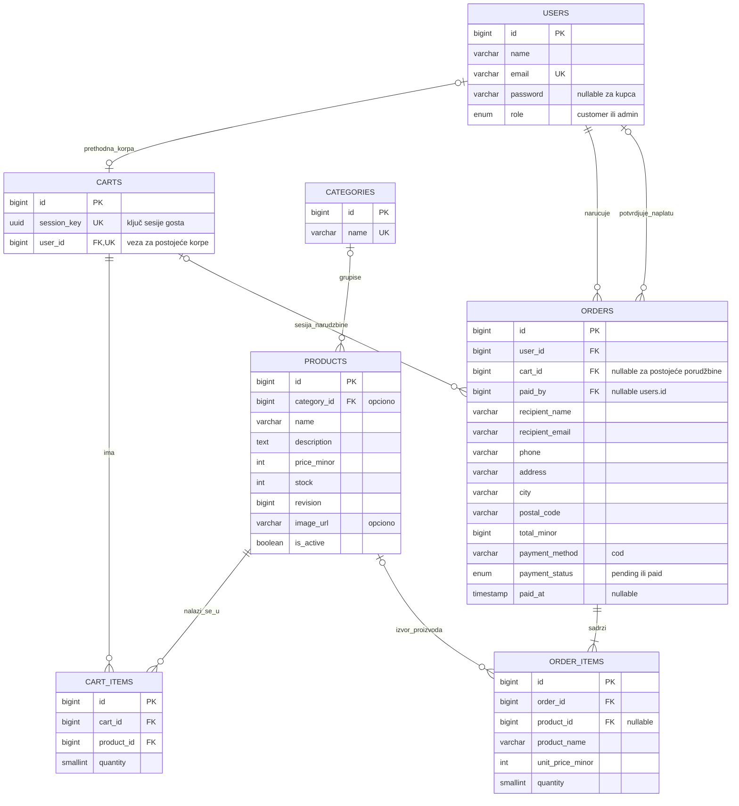

# BPA Shop

Demo prodavnica opreme za boravak napolju. Laravel 13, Blade, HTML i CSS, PHP 8.4 i MySQL 8.4. Docker Compose pokreće aplikaciju, MySQL, worker i lokalno SMTP sanduče Mailpit.

## Pokretanje

Za prvo pokretanje napravi lokalni `.env` sa nasumičnim Laravel ključem. Komanda koristi `openssl`.

```bash
key=$(openssl rand -base64 32)
sed "s|^APP_KEY=$|APP_KEY=base64:$key|" .env.example > .env
docker compose up -d --build
docker compose exec app php artisan db:seed --force
```

Ako je `.env` već podešen, kreni od `docker compose up -d --build`. Ako lokalni Docker nema Buildx, izgradi istu sliku sa `DOCKER_BUILDKIT=0 docker build -t bpa-commerce:local .`, pa pokreni `docker compose up -d --no-build`.

| Strana | Adresa |
| --- | --- |
| Prodavnica | [localhost:8015](http://localhost:8015/) |
| Admin | [localhost:8015/admin](http://localhost:8015/admin) |
| Mailpit | [localhost:8025](http://localhost:8025/) |

Demo admin je `admin@staza.test` sa lozinkom `StazaAdmin2026!`. Vrednosti su u `.env`, a seeder je ograničen na lokalno okruženje. Kupovina je dostupna gostima. Prijava i dodavanje korisnika dostupni su u administraciji. Seeder dodaje 24 demo proizvoda u šest kategorija. Prodavnica i admin lista proizvoda prikazuju po 12 proizvoda po strani. Migracije se izvršavaju pri pokretanju Compose servisa. MySQL podaci ostaju u Docker volumenu posle `docker compose down`.

## Šema baze



- **Kategorija** ima više proizvoda. Proizvod može pripadati jednoj kategoriji. Katalog nudi filter po kategoriji, a detalj proizvoda prikazuje do četiri druga aktivna proizvoda iz iste kategorije. Admin dodaje kategorije i bira kategoriju i količinu pri unosu artikla.
- **Korpa** pripada sesiji gosta. `cart_items` je asocijativna tabela između korpe i proizvoda. `UNIQUE(cart_id, product_id)` obezbeđuje jednu stavku po paru. Migracija prenosi ranije stavke korpe u `carts` i zadržava njihovu vezu sa korisnikom.
- **Porudžbina** povezuje kontakt kupca i njegovu sesiju. Pri prvoj kupovini se po emailu evidentira kupac bez lozinke. Stavke pamte naziv, jediničnu cenu i količinu iz trenutka kupovine. Admin arhivira proizvod promenom `is_active`. Strani ključ stavke porudžbine ima `SET NULL` kako bi istorija ostala dostupna i pri fizičkom brisanju proizvoda.
- **Novac** se čuva u parama kao ceo broj. `price_minor = 329000` prikazuje se kao 3.290,00 RSD.
- **Naplatu** evidentira admin iz iste tabele `users` preko posebnog stranog ključa `orders.paid_by`.

Izvor šeme su [Laravel migracije](database/migrations). U bazi možeš prikazati stvarne ključeve i indekse preko `SHOW CREATE TABLE cart_items\G` i `SHOW CREATE TABLE order_items\G` u MySQL konzoli:

```bash
docker compose exec mysql mysql -u staza -p staza
```

## Tok za demonstraciju

1. U prodavnici dodaj dva proizvoda u korpu i pošalji porudžbinu sa adresom dostave i emailom za potvrdu uplate.
2. Otvori **Moje porudžbine** u istom browseru. Nova porudžbina ima status **Čeka naplatu**.
3. U admin panelu otvori porudžbinu i izaberi **Potvrdi primljenu uplatu**. Status prelazi u **Plaćeno**, a potvrda se pojavljuje u Mailpitu.
4. U admin panelu otvori **Korisnici** i dodaj kupca ili administratora. Lozinka je potrebna za administratora.
5. U admin panelu dodaj, izmeni ili arhiviraj proizvod, pa osveži katalog. U mrežnom tabu browsera ponovljeni zahtev za nepromenjen katalog možeš da vidiš kao `304`. Posle izmene vidljivog proizvoda stiže novi `200` i promenjen `ETag`.

## Implementacija

- Zahtev ide kroz rutu i kontroler do servisa, a servis koristi Eloquent modele. Form Requests validiraju podatke iz obrazaca.
- Laravel sesija određuje pristup korpi i porudžbinama gosta. Admin dobija potpisani JWT sa rokom od 30 minuta u `HttpOnly`, `SameSite=Lax` kolačiću ograničenom na `/admin`. Middleware proverava potpis, rok, identifikator prijave u sesiji i trenutnu ulogu u bazi. Odjava poništava vezu između JWT-a i sesije. POST forme koriste Laravel CSRF zaštitu.
- Checkout u jednoj transakciji zaključava korpu i potrebne proizvode, proverava zalihe i prikazani iznos, upisuje porudžbinu i grupno upisuje stavke i stanje zaliha. Kolona `revision` štiti od prepisivanja zalihe zastarelim admin obrascem. Ako više kupaca pokuša da naruči poslednji komad, prvi potvrđen checkout smanjuje zalihu na nulu, a ostali zadržavaju korpu uz poruku o promenjenoj dostupnosti.
- Stranice korpe i porudžbina koriste `with()` i `withCount()` za relacije i agregate. Grupe stavki i zaliha upisuju se skupno, sa brojem SQL upita koji ne raste po stavci. Kataloške i admin liste imaju paginaciju. Javni katalog pretražuje naziv i opis, filtrira kategoriju, cenu i dostupnost, a linkovi za paginaciju zadržavaju kriterijume.
- Browser može da sačuva HTML kataloga uz `Cache-Control: private, no-cache, must-revalidate`. Pri sledećoj poseti šalje `If-None-Match`. `ETag` zavisi od HTML-a i revizija proizvoda na strani. Izmena proizvoda menja reviziju, a dodavanje ili arhiviranje menja sadržaj odgovarajuće strane. Katalog je isti za sve posetioce i servira se bez sesije. Privatne stranice kupca i admina imaju `no-store`.
- Potvrda naplate i unos u MySQL red poslova se upisuju u istoj transakciji. Ponavljanje potvrde zadržava postojeću naplatu i jedan posao za mejl. Worker isporučuje mejl na adresu kupca sačuvanu u porudžbini. Lokalni SMTP je Mailpit, a SMTP podešavanja su u `.env`.

## Provere

Van Dockera možeš pokrenuti automatizovane testove uz PHP i PDO SQLite posle `composer install` i podešavanja `.env`. Pokreni `php artisan test`. Testovi proveravaju kupovinu bez prijave, izolaciju porudžbina po sesiji, admin pristup i kreiranje korisnika, `ETag`, rollback pri promeni zalihe i jedan posao za potvrdu uplate.

## Demo fotografije

Ugrađeni ImageGen je generisao oba vizuala.

- Durmitor je generisan ovim promptom. “Wide 3:2 editorial photograph for an outdoor equipment web store: rugged pale limestone peaks of Durmitor behind a dark green pine forest in Montenegro, layered mountain ridges, a low band of moody clouds and warm late-afternoon light. Analog grain, rich spruce shadows, natural muted greens and stone tones. Place the most distinct mountain peak slightly right of center, no people, no buildings, absolutely no text or logos.” [Durmitor](public/images/durmitor.webp)
- Kataloške slike su generisane ovim promptom. “A square 2 by 2 contact sheet of four individual outdoor equipment studio product photographs. Each quadrant strictly equal size, no gutters, each product entirely inside its quadrant with ample space around it. Upper left: single upright dark moss green hiking backpack on pale sage backdrop. Upper right: single upright matte black stainless steel thermos on light cool gray backdrop. Lower left: single mustard yellow waist pack on light oatmeal backdrop. Lower right: single forest green rolled camping mat with straps on light sage backdrop. Stylish modern outdoor ecommerce catalog shooting, tactile realistic materials, soft diffused daylight. No lettering, no logos, no labels, no watermark.” [Fotografije proizvoda](public/images/oprema.webp)
- Dodatne kataloške slike su generisane ugrađenim ImageGen alatom. Prompt traži preciznu mrežu 4 × 5 jednako velikih kvadratnih fotografija outdoor proizvoda, sa centriranim predmetima, blagim studijskim senkama i jednobojnim pozadinama, bez teksta ili brendova. Redosled proizvoda prati skup `$additionalProducts` u seederu. [Dodatne fotografije proizvoda](public/images/oprema-dodatna.webp)
